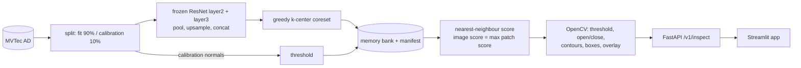
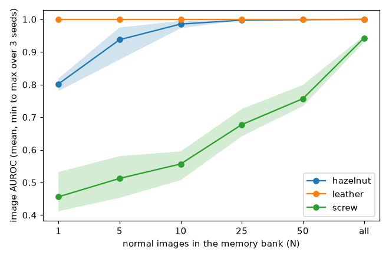
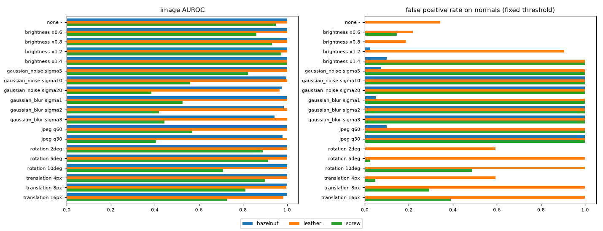

# Industrial visual inspection with PatchCore on MVTec AD

A from-scratch implementation of PatchCore (pretrained CNN feature extraction, a coreset memory bank of normal patches, nearest-neighbour anomaly scoring) that detects defective parts and localises defects at pixel level using only defect-free training images. It covers all 15 MVTec AD categories, is measured on CPU (accuracy, localisation, latency, throughput, memory), and is served through a FastAPI service with a Streamlit client, plus Docker files, tests and CI configuration.

**Headline (all from `results/`, test split of MVTec AD, seed 0):** mean image AUROC 0.985, mean pixel AUROC 0.977, mean AU-PRO 0.906 over 15 categories. Weakest categories by image AUROC: screw (0.950), pill (0.956), grid (0.964). Median model-only latency 614 ms per image on this CPU-only laptop (AMD Ryzen 5 3500U with Radeon Vega Mobile Gfx; about 1.76 images per second, one image at a time). At the label-free calibrated threshold the mean F1 is 0.936 (oracle F1, chosen with test labels: 0.978) and the mean false positive rate on test normals is 0.094.

> Screenshots / demo GIF: record your own and drop it here (the Streamlit app runs with `make app`).

## Architecture



The full diagram with module names is in [docs/ARCHITECTURE.md](docs/ARCHITECTURE.md).

## Quick start

```bash
pip install --extra-index-url https://download.pytorch.org/whl/cpu -r requirements-dev.txt && pip install -e . --no-deps
mvinspect fetch-data && mvinspect train --all && mvinspect evaluate --all
mvinspect serve   # then: make app
```

Trained artifacts are not committed (`artifacts/` is git-ignored), so train first, or see [HANDOFF.md](HANDOFF.md) for exact steps and measured run times. The dataset is not committed either.

## Method summary

- **Backbone.** Torchvision ResNet-50 with ImageNet weights, eval mode, frozen. This is pretrained CNN feature extraction; nothing is fine-tuned. Features come from `layer2` (512 x 28 x 28) and `layer3` (1024 x 14 x 14) at 224 input.
- **Patch descriptors.** 3 x 3 average pooling for local aggregation, bilinear upsampling of `layer3`, concatenation: 784 descriptors of 1536 dimensions per image.
- **Memory bank.** Approximate greedy k-center selection (distances computed in a fixed 128-dimensional Gaussian projection) keeps 10 percent of the fit-split patches. Original descriptors are stored.
- **Scoring.** Patch score = Euclidean distance to the nearest bank entry; image score = maximum patch score; anomaly map = patch scores upsampled bilinearly to 224 x 224 and Gaussian blurred (sigma 4).
- **Threshold.** The maximum image score over calibration normals (10 percent of `train/good`, at least 10 images). No test labels are used. The pixel threshold is the same value. With about 20 to 30 calibration images this is noisy, so the calibrated operating point is always shown next to threshold-free AUROC and the oracle point.
- **One model per category.** Matches a station that inspects one product type; the API takes the category as input.
- **Input.** Resize to 256, center crop 224, ImageNet normalisation; masks use the same geometry with nearest-neighbour resizing. Center cropping can remove defects at the image border.
- **No PatchCore library.** Everything above is implemented here (`src/inspection`); `anomalib` and similar libraries are not used. ImageNet weights are downloaded from the PyTorch model zoo on first use and their checksum is stored in every artifact manifest.
- **Why these choices:** see [docs/DECISIONS.md](docs/DECISIONS.md).

## Results

Dataset facts verified by `mvinspect verify-data`: 15 categories, 5354 images (3629 train, 1725 test), the test split holds 467 defect-free and 1258 defective images. **About 73 percent of the test set is defective**, unlike a real line, which matters for precision and for the cascade analysis. All numbers below are generated from `results/` by `scripts/render_docs.py`.

### Per-category accuracy and localisation

Image AUROC has a 95 percent bootstrap confidence interval (1000 resamples, seed 0). Pixel AUROC is over all pixels at 224 x 224. AU-PRO is a re-implementation at 224 x 224 (up to FPR 0.3, 200 thresholds), so it may differ slightly from the official evaluation code. Precision, recall, F1 and the FPR on test normals are at the calibrated threshold; "oracle F1" is the best F1 over thresholds chosen with test labels (analysis only).

| category | image AUROC (95% CI) | pixel AUROC | AU-PRO | precision | recall | f1 | FPR on normals | oracle F1 |
|---|---|---|---|---|---|---|---|---|
| bottle | 1.000 (1.000 to 1.000) | 0.983 | 0.929 | 1.000 | 1.000 | 1.000 | 0.000 | 1.000 |
| cable | 0.994 (0.984 to 0.999) | 0.985 | 0.922 | 0.967 | 0.967 | 0.967 | 0.052 | 0.979 |
| capsule | 0.968 (0.929 to 0.994) | 0.987 | 0.916 | 0.978 | 0.835 | 0.901 | 0.087 | 0.977 |
| carpet | 0.969 (0.935 to 0.992) | 0.985 | 0.912 | 0.888 | 0.978 | 0.930 | 0.393 | 0.948 |
| grid | 0.964 (0.919 to 0.996) | 0.969 | 0.874 | 0.947 | 0.947 | 0.947 | 0.143 | 0.957 |
| hazelnut | 1.000 (1.000 to 1.000) | 0.984 | 0.928 | 1.000 | 1.000 | 1.000 | 0.000 | 1.000 |
| leather | 1.000 (1.000 to 1.000) | 0.989 | 0.961 | 0.893 | 1.000 | 0.944 | 0.344 | 1.000 |
| metal_nut | 0.997 (0.988 to 1.000) | 0.986 | 0.921 | 0.989 | 0.989 | 0.989 | 0.045 | 0.989 |
| pill | 0.956 (0.923 to 0.984) | 0.973 | 0.922 | 0.991 | 0.787 | 0.877 | 0.038 | 0.952 |
| screw | 0.950 (0.915 to 0.977) | 0.990 | 0.944 | 1.000 | 0.487 | 0.655 | 0.000 | 0.934 |
| tile | 0.988 (0.964 to 1.000) | 0.951 | 0.790 | 1.000 | 0.905 | 0.950 | 0.000 | 0.988 |
| toothbrush | 1.000 (1.000 to 1.000) | 0.987 | 0.860 | 0.968 | 1.000 | 0.984 | 0.083 | 1.000 |
| transistor | 1.000 (0.997 to 1.000) | 0.967 | 0.940 | 0.889 | 1.000 | 0.941 | 0.083 | 0.988 |
| wood | 0.989 (0.970 to 1.000) | 0.941 | 0.839 | 0.983 | 0.967 | 0.975 | 0.053 | 0.975 |
| zipper | 0.997 (0.990 to 1.000) | 0.983 | 0.928 | 0.975 | 0.992 | 0.983 | 0.094 | 0.988 |
| MEAN | 0.985 (0.968 to 0.996) | 0.977 | 0.906 | 0.965 | 0.924 | 0.936 | 0.094 | 0.978 |

Categories at image AUROC of at least 0.999: bottle, hazelnut, leather, toothbrush, transistor. The sanity expectation (bottle, leather and tile near perfect; screw and capsule among the lowest) holds for bottle and leather and tile (0.988); screw is the lowest, capsule is in the lower group together with pill and grid.

The calibrated operating point is much less reliable than the AUROC: on carpet and leather it flags a large share of normal test images (FPR column) because the threshold is the maximum over only a few calibration images, while on screw it is so conservative that recall is low although AUROC is high. This is the cost of a label-free threshold from a small calibration set, and the reason the oracle column is shown.

### Comparison with published PatchCore numbers

Published values are from Roth et al., "Towards Total Recall in Industrial Anomaly Detection", CVPR 2022 (arXiv 2106.08265), supplementary tables, 10 percent coreset. That paper uses a WideResNet-50 backbone and different settings, so the comparison is indicative only. The values were read from an HTML rendering through a summarising tool and should be checked against the PDF before being quoted precisely (see DECISIONS D10). Values are in percent.

| category | image AUROC | pixel AUROC | published image auroc | published pixel auroc | image delta | pixel delta |
|---|---|---|---|---|---|---|
| bottle | 100.00 | 98.29 | 100.00 | 98.60 | 0.00 | -0.31 |
| cable | 99.38 | 98.46 | 99.40 | 98.50 | -0.02 | -0.04 |
| capsule | 96.85 | 98.70 | 97.80 | 98.90 | -0.95 | -0.20 |
| carpet | 96.91 | 98.55 | 98.70 | 99.10 | -1.79 | -0.55 |
| grid | 96.41 | 96.85 | 97.90 | 98.70 | -1.49 | -1.85 |
| hazelnut | 100.00 | 98.45 | 100.00 | 98.70 | 0.00 | -0.25 |
| leather | 100.00 | 98.92 | 100.00 | 99.30 | 0.00 | -0.38 |
| metal_nut | 99.66 | 98.56 | 100.00 | 98.40 | -0.34 | 0.16 |
| pill | 95.61 | 97.28 | 96.00 | 97.60 | -0.39 | -0.32 |
| screw | 94.98 | 98.96 | 97.00 | 99.40 | -2.02 | -0.44 |
| tile | 98.81 | 95.06 | 98.90 | 95.90 | -0.09 | -0.84 |
| toothbrush | 100.00 | 98.67 | 99.70 | 98.70 | 0.30 | -0.03 |
| transistor | 99.96 | 96.75 | 100.00 | 96.40 | -0.04 | 0.35 |
| wood | 98.95 | 94.09 | 99.00 | 95.10 | -0.05 | -1.01 |
| zipper | 99.68 | 98.27 | 99.50 | 98.90 | 0.18 | -0.63 |
| MEAN | 98.48 | 97.72 | 98.93 | 98.15 | -0.45 | -0.42 |

Mean difference to the published numbers: -0.45 points image AUROC and -0.42 points pixel AUROC. 12 of 15 categories are within one point on image AUROC; the largest gaps are screw (-2.02), carpet (-1.79), grid (-1.49). The differences are small and of mixed sign on pixel AUROC for a few categories, which is what one would expect from a different backbone and implementation details (see DECISIONS D7).

### Latency, throughput and memory

One image at a time, model only (decoded tensor to score and map), after 5 warm-up images, 60 images spread over the test split, PyTorch with exact nearest-neighbour search (a chunked matrix product, no approximation), 4 threads, on a laptop with an AMD Ryzen 5 3500U with Radeon Vega Mobile Gfx (4 physical, 8 logical, 6.94 GB RAM; no discrete GPU, and the integrated graphics were not used). Memory is process resident memory after model load and the peak during the latency run. The largest peak over categories is 982 MB, well below the 5 GB budget. Memory bank sizes range from 23 to 162 MB.

| category | p50 ms | p95 ms | fps | rss after load mb | peak rss mb | bank mb |
|---|---|---|---|---|---|---|
| bottle | 667.3 | 750.0 | 1.5 | 651.4 | 752.6 | 86.4 |
| cable | 685.9 | 718.4 | 1.5 | 727.4 | 833.1 | 92.8 |
| capsule | 600.1 | 748.6 | 1.6 | 747.5 | 796.0 | 90.5 |
| carpet | 635.4 | 709.5 | 1.5 | 755.6 | 883.4 | 115.8 |
| grid | 622.1 | 659.4 | 1.6 | 803.5 | 843.9 | 109.3 |
| hazelnut | 870.8 | 907.8 | 1.1 | 869.9 | 982.0 | 161.7 |
| leather | 590.4 | 657.7 | 1.7 | 741.5 | 835.8 | 101.5 |
| metal_nut | 544.6 | 567.8 | 1.8 | 683.9 | 817.5 | 91.0 |
| pill | 626.1 | 657.9 | 1.6 | 801.5 | 890.6 | 110.2 |
| screw | 735.4 | 772.8 | 1.4 | 834.3 | 906.2 | 132.3 |
| tile | 557.7 | 590.7 | 1.8 | 772.5 | 834.5 | 95.1 |
| toothbrush | 225.9 | 251.3 | 4.3 | 593.1 | 607.9 | 23.0 |
| transistor | 527.2 | 552.9 | 1.9 | 671.5 | 813.7 | 88.2 |
| wood | 590.4 | 624.9 | 1.7 | 795.5 | 832.8 | 102.0 |
| zipper | 729.0 | 788.2 | 1.4 | 748.1 | 856.5 | 99.2 |
| MEAN | 613.9 | 663.9 | 1.8 | 746.5 | 832.4 | 99.9 |

Total measured runtimes in seconds (training ran in the background alongside other work, so training times are upper bounds):

| category | evaluate seconds | train seconds |
|---|---|---|
| bottle | 110 | 375 |
| cable | 168 | 348 |
| capsule | 144 | 340 |
| carpet | 136 | 554 |
| grid | 92 | 464 |
| hazelnut | 161 | 1070 |
| leather | 120 | 364 |
| metal_nut | 102 | 227 |
| pill | 153 | 321 |
| screw | 169 | 447 |
| tile | 109 | 247 |
| toothbrush | 26 | 24 |
| transistor | 96 | 217 |
| wood | 94 | 283 |
| zipper | 148 | 263 |

Sum of training times: 92 minutes; sum of evaluation times: 30 minutes. Bottle was retrained and re-evaluated in a later session after a timing bug was fixed (see docs/KNOWN_ISSUES.md), so its row comes from that session; its accuracy is unchanged.

#### Inference backends

The feature extractor (including pooling, upsampling and concatenation) exports to ONNX with a maximum absolute feature difference far below the 1e-3 target (see `results/inference_benchmark.json`). Two benchmark runs on bottle, model only, p50 and p95 in milliseconds:

| run | combination | p50 ms | p95 ms |
|---|---|---|---|
| inference_benchmark | torch+torch | 522 | 545 |
| inference_benchmark | torch+faiss | 502 | 518 |
| inference_benchmark | onnx+torch | 512 | 533 |
| inference_benchmark | onnx+faiss | 462 | 485 |
| inference_benchmark_run1 | torch+torch | 572 | 746 |
| inference_benchmark_run1 | torch+faiss | 581 | 611 |
| inference_benchmark_run1 | onnx+torch | 579 | 614 |
| inference_benchmark_run1 | onnx+faiss | 543 | 562 |

ONNX Runtime plus faiss was fastest in both runs, by a modest margin, so the API serves with those backends by default (config `api.extractor_backend` and `api.knn_backend`, with automatic fallback to PyTorch). Training and the reported evaluation use PyTorch for reproducibility.

#### API load test

Real bottle images, client concurrency 1, 2 and 4, against servers with 1 and 2 inference slots (`scripts/load_test.py`, raw files `results/load_test_*.json`). Latency is end-to-end including upload and decoding:

| server | concurrency | requests | errors | p50 ms | p95 ms | throughput rps |
|---|---|---|---|---|---|---|
| server_concurrency_1 | 1 | 24 | 0 | 585.5 | 602.2 | 1.7 |
| server_concurrency_1 | 2 | 24 | 0 | 1104.7 | 1123.5 | 1.8 |
| server_concurrency_1 | 4 | 24 | 0 | 2194.0 | 2218.2 | 1.8 |
| server_concurrency_2 | 1 | 24 | 0 | 578.0 | 595.0 | 1.7 |
| server_concurrency_2 | 2 | 24 | 0 | 967.6 | 999.3 | 2.1 |
| server_concurrency_2 | 4 | 24 | 0 | 1877.1 | 1979.4 | 2.1 |

### OpenCV post-processing

Flagged images are binarised at the pixel threshold, cleaned with a morphological opening then closing (5 x 5 ellipse), contours below 30 pixels are dropped and `boundingRect` gives the boxes. Quantified against ground truth masks on defective test images that the model flagged. A box counts as a hit when its IoU with the bounding rectangle of a ground truth region is at least 0.1. Mean over categories: IoU 0.330 raw against 0.329 cleaned, Dice 0.452 raw against 0.451 cleaned, box hit rate 0.843, box precision 0.839.

**The morphological cleanup does not help measurably**: the raw thresholded map is already smooth because of the Gaussian blur, so opening and closing change almost nothing. Its practical value is limited to dropping tiny contours when boxes are drawn. Figures: `results/figures/postprocess/`.

| category | flagged defective images | IoU raw | IoU cleaned | Dice raw | Dice cleaned | box hit rate | box precision | boxes per image |
|---|---|---|---|---|---|---|---|---|
| bottle | 63 | 0.541 | 0.541 | 0.684 | 0.684 | 0.968 | 0.939 | 1.048 |
| cable | 89 | 0.411 | 0.411 | 0.533 | 0.532 | 0.820 | 0.848 | 1.180 |
| capsule | 91 | 0.288 | 0.283 | 0.415 | 0.407 | 0.857 | 0.886 | 0.967 |
| carpet | 87 | 0.290 | 0.290 | 0.415 | 0.415 | 0.931 | 0.736 | 1.264 |
| grid | 54 | 0.204 | 0.203 | 0.320 | 0.318 | 0.833 | 0.883 | 1.426 |
| hazelnut | 70 | 0.367 | 0.367 | 0.514 | 0.513 | 0.986 | 0.958 | 1.029 |
| leather | 92 | 0.066 | 0.066 | 0.119 | 0.119 | 0.359 | 0.324 | 1.109 |
| metal_nut | 92 | 0.556 | 0.556 | 0.686 | 0.685 | 0.935 | 0.963 | 1.163 |
| pill | 111 | 0.263 | 0.263 | 0.363 | 0.362 | 0.640 | 0.809 | 0.847 |
| screw | 58 | 0.222 | 0.221 | 0.317 | 0.316 | 0.552 | 0.865 | 0.638 |
| tile | 76 | 0.448 | 0.448 | 0.563 | 0.562 | 0.934 | 0.947 | 1.000 |
| toothbrush | 30 | 0.228 | 0.228 | 0.357 | 0.357 | 0.900 | 0.854 | 1.367 |
| transistor | 40 | 0.383 | 0.383 | 0.539 | 0.539 | 1.000 | 0.793 | 1.450 |
| wood | 58 | 0.301 | 0.300 | 0.436 | 0.435 | 0.948 | 0.885 | 2.103 |
| zipper | 118 | 0.375 | 0.376 | 0.526 | 0.526 | 0.983 | 0.901 | 1.458 |
| MEAN | 75.267 | 0.330 | 0.329 | 0.452 | 0.451 | 0.843 | 0.839 | 1.203 |

Alpha sensitivity (pixel threshold multiplied by alpha, averaged over categories; analysis only, never used to set the deployed value):

| alpha | mean IoU (defective) | mean Dice (defective) | pixels flagged on normals | normal images with any flagged pixel |
|---|---|---|---|---|
| 0.600 | 0.082 | 0.129 | 0.632 | 0.994 |
| 0.700 | 0.123 | 0.190 | 0.294 | 0.937 |
| 0.800 | 0.211 | 0.310 | 0.086 | 0.681 |
| 0.900 | 0.294 | 0.412 | 0.012 | 0.205 |
| 1.000 | 0.310 | 0.425 | 0.001 | 0.063 |
| 1.100 | 0.280 | 0.382 | 0.000 | 0.005 |
| 1.200 | 0.220 | 0.304 | 0.000 | 0.000 |

### Two-stage cascade

Stage 1 is ResNet-18 at 128 x 128 with global-average-pooled embeddings and nearest fit-split embedding distance. Images scoring at or below the q-th percentile of calibration normals skip PatchCore. The quantile was never tuned on test data. Skipped images get the lowest possible score for AUROC. Mean latency is computed from the measured per-stage mean latencies and the measured skip fractions (not timing the combined process). This is an engineering trade-off built and measured here on a benchmark whose test set is 73 percent defective.

Mean over categories (q = 0 is PatchCore alone):

| q | normal skipped | defective wrongly skipped | image AUROC | precision | recall | f1 | patchcore f1 | mean latency ms | speedup |
|---|---|---|---|---|---|---|---|---|---|
| 0 | 0.000 | 0.000 | 0.985 | 0.965 | 0.924 | 0.936 | 0.936 | 617.223 | 1.000 |
| 25 | 0.156 | 0.030 | 0.961 | 0.966 | 0.902 | 0.925 | 0.936 | 611.774 | 1.007 |
| 50 | 0.358 | 0.088 | 0.921 | 0.966 | 0.857 | 0.899 | 0.936 | 550.508 | 1.140 |
| 75 | 0.619 | 0.199 | 0.867 | 0.969 | 0.758 | 0.833 | 0.936 | 457.524 | 1.518 |

At q = 50 the cascade skips 0.358 of normal test images and wrongly skips 0.088 of defective ones for a speed-up of only 1.14 on this defect-heavy benchmark mix; at q = 75 it wrongly skips 0.199 of defects. Where stage 1 fails is visible in the per-category table below (`defective_wrongly_skipped`).

Per category at q = 50:

| category | normal skipped | defective wrongly skipped | f1 | patchcore f1 | speedup |
|---|---|---|---|---|---|
| bottle | 0.400 | 0.000 | 1.000 | 1.000 | 1.043 |
| cable | 0.431 | 0.033 | 0.950 | 0.967 | 1.150 |
| capsule | 0.304 | 0.083 | 0.867 | 0.901 | 1.061 |
| carpet | 0.179 | 0.034 | 0.913 | 0.930 | 1.003 |
| grid | 0.381 | 0.386 | 0.745 | 0.947 | 1.474 |
| hazelnut | 0.625 | 0.029 | 0.986 | 1.000 | 1.249 |
| leather | 0.031 | 0.000 | 0.944 | 0.944 | 0.945 |
| metal_nut | 0.273 | 0.086 | 0.944 | 0.989 | 1.051 |
| pill | 0.385 | 0.227 | 0.802 | 0.877 | 1.233 |
| screw | 0.415 | 0.134 | 0.624 | 0.655 | 1.180 |
| tile | 0.455 | 0.071 | 0.930 | 0.950 | 1.125 |
| toothbrush | 0.417 | 0.067 | 0.949 | 0.984 | 1.000 |
| transistor | 0.633 | 0.175 | 0.868 | 0.941 | 1.604 |
| wood | 0.158 | 0.000 | 0.975 | 0.975 | 0.973 |
| zipper | 0.281 | 0.000 | 0.983 | 0.983 | 1.009 |

Production-mix calculation (a calculation from the measured per-class skip rates and latencies, reweighted to defect rates of 1, 5 and 20 percent, not a measurement):

| q | defect rate | skip rate | mean latency ms | speedup | defects wrongly skipped per 1000 items |
|---|---|---|---|---|---|
| 0 | 0.010 | 0.000 | 617.223 | 1.000 | 0.000 |
| 0 | 0.050 | 0.000 | 617.223 | 1.000 | 0.000 |
| 0 | 0.200 | 0.000 | 617.223 | 1.000 | 0.000 |
| 25 | 0.010 | 0.155 | 556.137 | 1.114 | 0.300 |
| 25 | 0.050 | 0.150 | 559.410 | 1.107 | 1.502 |
| 25 | 0.200 | 0.131 | 571.686 | 1.080 | 6.008 |
| 50 | 0.010 | 0.355 | 435.129 | 1.479 | 0.883 |
| 50 | 0.050 | 0.344 | 441.921 | 1.449 | 4.413 |
| 50 | 0.200 | 0.304 | 467.392 | 1.351 | 17.653 |
| 75 | 0.010 | 0.615 | 274.078 | 3.066 | 1.989 |
| 75 | 0.050 | 0.598 | 284.537 | 2.806 | 9.947 |
| 75 | 0.200 | 0.535 | 323.759 | 2.215 | 39.789 |

### Failure analysis

The three weakest categories by image AUROC. Figures with the worst false negatives (lowest-scoring defective images) and worst false positives are in `results/figures/failures/`.

| category | image AUROC | false negatives | false positives | missed defect types |
|---|---|---|---|---|
| screw | 0.950 | 61 | 0 | manipulated_front (16), scratch_head (15), scratch_neck (4), thread_side (19), thread_top (7) |
| pill | 0.956 | 30 | 1 | color (6), contamination (4), crack (12), faulty_imprint (4), scratch (4) |
| grid | 0.964 | 3 | 3 | glue (3) |

What the three failure cases show (numbers from the tables above, figures in `results/figures/failures/`):

- **screw.** Image AUROC is 0.950 but recall at the calibrated threshold is only 0.487 with a false positive rate of 0.000: F1 0.655 against an oracle F1 of 0.934. The ranking of images is good; the label-free threshold sits above about half of the defective scores. Interpretation (not tested directly): screws lie in arbitrary rotations, so normal patches vary more than on aligned products, which pushes the calibration maximum up. The few-shot study below is consistent with this: screw is the one category whose AUROC keeps rising until nearly all training images are used.
- **pill.** The most frequently missed defect type is crack, and the anomaly maps of the missed cracks and scratches are only weakly lit. The single false positive is a normal pill with dense dark speckle that lands just above the threshold.
- **grid.** Only three defective images are missed (all glue) and three normal images are flagged, all close to the threshold. The grids are photographed at visibly different tilts, a source of normal variation that the memory bank has to cover.

In all three categories the misses and false alarms sit near the threshold rather than far from it, so the oracle column quantifies how much of the loss comes from the threshold and how much from the scores.

## Studies (leather, hazelnut, screw)

The studies are not needed to use the system. They ask narrow questions about the trained models on three categories of different character (a uniform texture, a natural object, and a part photographed in arbitrary orientation).

**How they were run.** The studies ran on a free Colab T4 GPU (`device: cuda`, driven by `scripts/colab_run.py` and `notebooks/colab_studies.ipynb`) instead of this CPU laptop, because the coreset step makes them slow on a CPU. Latency is therefore not measured in the studies, except for the coreset ratio banks, which were rebuilt from the saved selection order and timed on the CPU. To check that the GPU path does not change results, the GPU baseline (same config, split and seed as the laptop run) is compared with the CPU main run:

| category | image auroc cpu | image auroc gpu | pixel auroc cpu | pixel auroc gpu | image auroc abs diff | pixel auroc abs diff | threshold cpu | threshold gpu |
|---|---|---|---|---|---|---|---|---|
| leather | 1.0000 | 1.0000 | 0.9892 | 0.9892 | 0.0e+00 | 8.7e-07 | 1.3589 | 1.3589 |
| hazelnut | 1.0000 | 1.0000 | 0.9845 | 0.9845 | 0.0e+00 | 1.7e-06 | 2.4519 | 2.4519 |
| screw | 0.9498 | 0.9498 | 0.9896 | 0.9896 | 0.0e+00 | 1.0e-06 | 1.7818 | 1.7818 |

Image AUROC, the number of bank rows and the calibrated threshold are identical, and pixel AUROC differs only in the sixth decimal. In addition, 6 leather robustness settings were computed on both devices (a CPU run stopped when the studies moved to the GPU, kept in `results/studies_cpu_partial/`); their largest AUROC difference is 0.0e+00. The studies took about 19 minutes in total on the GPU (read from the Colab console, not stored in `results/`). Earlier measurements of the same coreset step on this CPU suggested several hours, which is an estimate and not a measurement.

### Seed spread (the yardstick for every ablation)

Seed changes the calibration split and the coreset starting point. Differences smaller than this spread are not meaningful. Image AUROC range over 3 seeds: leather 0.0000, hazelnut 0.0000, screw 0.0205.

| category | seed | image AUROC | pixel AUROC | fpr normals |
|---|---|---|---|---|
| hazelnut | 0 | 1.0000 | 0.9845 | 0.0000 |
| hazelnut | 1 | 1.0000 | 0.9843 | 0.0000 |
| hazelnut | 2 | 1.0000 | 0.9844 | 0.0000 |
| leather | 0 | 1.0000 | 0.9892 | 0.3438 |
| leather | 1 | 1.0000 | 0.9893 | 0.2500 |
| leather | 2 | 1.0000 | 0.9892 | 0.8125 |
| screw | 0 | 0.9498 | 0.9896 | 0.0000 |
| screw | 1 | 0.9293 | 0.9896 | 0.0000 |
| screw | 2 | 0.9486 | 0.9905 | 0.0000 |

The calibrated false positive rate moves a lot with the seed even when AUROC does not: leather ranges over 0.25 to 0.81 across the three calibration splits, hazelnut over 0.00 to 0.00 and screw over 0.00 to 0.00, which means their thresholds sat above every normal test image on every seed. A threshold from about 20 to 30 calibration images is the weakest part of this pipeline.

### Coreset ratio

| category | ratio | image AUROC | pixel AUROC | fpr normals | CPU p50 ms | bank MB |
|---|---|---|---|---|---|---|
| hazelnut | 0.01 | 1.000 | 0.985 | 0.000 | 266 | 16.2 |
| hazelnut | 0.1 | 1.000 | 0.984 | 0.000 | 1039 | 161.7 |
| hazelnut | 0.25 | 1.000 | 0.984 | 0.000 | 2502 | 404.2 |
| leather | 0.01 | 1.000 | 0.989 | 0.219 | 205 | 10.2 |
| leather | 0.1 | 1.000 | 0.989 | 0.344 | 731 | 101.5 |
| leather | 0.25 | 1.000 | 0.989 | 0.312 | 1548 | 253.8 |
| screw | 0.01 | 0.924 | 0.984 | 0.049 | 225 | 13.2 |
| screw | 0.1 | 0.950 | 0.990 | 0.000 | 896 | 132.3 |
| screw | 0.25 | 0.944 | 0.990 | 0.000 | 2055 | 330.8 |

Bank size grows in proportion to the ratio. CPU latency grows with it on top of a fixed cost that the 1 percent row shows (feature extraction). The latency column was measured in one session and is not comparable with the main latency table, which was measured in a different session. Accuracy does not need a large bank: the 25 percent bank gives no gain over 10 percent on any of the three categories, and the 1 percent bank is equal on leather and hazelnut. Screw is the exception: its image AUROC falls from 0.950 at 10 percent to 0.924 at 1 percent, slightly more than the seed spread, so a small bank costs accuracy where the normal data is diverse.

### Preprocessing and backbone

Preprocessing and backbone variants against the baseline (the main run). Coreset ratios and seeds are in the tables above.

| category | variant | image AUROC | pixel AUROC | fpr normals |
|---|---|---|---|---|
| hazelnut | baseline (main run) | 1.0000 | 0.9845 | 0.0000 |
| hazelnut | pre_gaussian_blur_k3_s1 | 0.9996 | 0.9837 | 0.0250 |
| hazelnut | pre_cielab | 1.0000 | 0.9835 | 0.0250 |
| hazelnut | pre_gray_opening_3x3 | 0.9989 | 0.9817 | 0.0250 |
| hazelnut | backbone_wide_resnet50_2 | 1.0000 | 0.9841 | 0.0000 |
| leather | baseline (main run) | 1.0000 | 0.9892 | 0.3438 |
| leather | pre_gaussian_blur_k3_s1 | 1.0000 | 0.9904 | 0.4062 |
| leather | pre_cielab | 0.9151 | 0.9762 | 0.3750 |
| leather | pre_gray_opening_3x3 | 1.0000 | 0.9876 | 0.1875 |
| leather | backbone_wide_resnet50_2 | 1.0000 | 0.9906 | 0.2500 |
| screw | baseline (main run) | 0.9498 | 0.9896 | 0.0000 |
| screw | pre_gaussian_blur_k3_s1 | 0.9494 | 0.9889 | 0.0000 |
| screw | pre_cielab | 0.9133 | 0.9894 | 0.0244 |
| screw | pre_gray_opening_3x3 | 0.9508 | 0.9894 | 0.0000 |
| screw | backbone_wide_resnet50_2 | 0.9522 | 0.9876 | 0.0488 |

- Gaussian blur (3 x 3, sigma 1) and the grayscale opening change nothing beyond the seed spread, with one small exception: hazelnut with the opening, 0.999 against 1.000.
- The CIELAB transform hurts: leather image AUROC drops to 0.915 and screw to 0.913, both beyond the seed spread. A plausible reason is that the pretrained backbone expects RGB statistics and receives LAB channels as if they were RGB. That explanation was not tested.
- Wide ResNet-50-2 against ResNet-50: no meaningful difference (screw 0.952 against 0.950, within the seed spread).

### Few-shot: how many normal images are needed

Memory bank built from N normal images (three seeds, which also change the calibration split; the "all" row is the main run plus the two seed baselines). Spread is min and max over seeds.

| category | n | auroc mean | auroc min | auroc max | fpr mean |
|---|---|---|---|---|---|
| hazelnut | 1 | 0.8019 | 0.7800 | 0.8186 | 0.0417 |
| hazelnut | 5 | 0.9375 | 0.8764 | 0.9750 | 0.0417 |
| hazelnut | 10 | 0.9855 | 0.9725 | 0.9954 | 0.0083 |
| hazelnut | 25 | 0.9975 | 0.9971 | 0.9979 | 0.0250 |
| hazelnut | 50 | 0.9988 | 0.9982 | 0.9993 | 0.0250 |
| hazelnut | all | 1.0000 | 1.0000 | 1.0000 | 0.0000 |
| leather | 1 | 1.0000 | 1.0000 | 1.0000 | 0.1146 |
| leather | 5 | 1.0000 | 1.0000 | 1.0000 | 0.4167 |
| leather | 10 | 1.0000 | 1.0000 | 1.0000 | 0.4896 |
| leather | 25 | 1.0000 | 1.0000 | 1.0000 | 0.4896 |
| leather | 50 | 1.0000 | 1.0000 | 1.0000 | 0.4167 |
| leather | all | 1.0000 | 1.0000 | 1.0000 | 0.4688 |
| screw | 1 | 0.4560 | 0.4118 | 0.5319 | 0.0732 |
| screw | 5 | 0.5123 | 0.4528 | 0.5804 | 0.0488 |
| screw | 10 | 0.5567 | 0.5071 | 0.5952 | 0.0325 |
| screw | 25 | 0.6773 | 0.6413 | 0.7251 | 0.0488 |
| screw | 50 | 0.7568 | 0.7338 | 0.7989 | 0.0325 |
| screw | all | 0.9425 | 0.9293 | 0.9498 | 0.0000 |



Leather is solved by a single image (AUROC 1.000), as expected for a uniform texture, although its calibrated false positive rate stays high. Hazelnut needs about ten images: 0.802 at N = 1, 0.985 at N = 10, 0.998 at N = 25. Screw is far behind even at 50 images (0.757, against 0.943 with the full fit split), and at N = 1 it is below chance (0.456), meaning normal test images score higher on average than defective ones. One reference image of a part that appears in many poses is a poor reference (interpretation, not tested directly). For bank sizes below 1000 rows the bank holds all patches of the chosen images (see DECISIONS D5).

### Robustness to image perturbations

The model and the calibrated threshold stay fixed; test images are perturbed after cropping. Each cell is image AUROC (change from the unperturbed run) and the false positive rate on normals at the fixed threshold.



| perturbation | severity | hazelnut | leather | screw |
|---|---|---|---|---|
| none | - | 1.000 (+0.000) / FPR 0.00 | 1.000 (+0.000) / FPR 0.34 | 0.950 (+0.000) / FPR 0.00 |
| brightness | x0.6 | 1.000 (+0.000) / FPR 0.00 | 1.000 (+0.000) / FPR 0.22 | 0.861 (-0.089) / FPR 0.15 |
| brightness | x0.8 | 1.000 (+0.000) / FPR 0.00 | 1.000 (+0.000) / FPR 0.19 | 0.932 (-0.018) / FPR 0.00 |
| brightness | x1.2 | 1.000 (+0.000) / FPR 0.03 | 1.000 (+0.000) / FPR 0.91 | 0.973 (+0.023) / FPR 0.00 |
| brightness | x1.4 | 1.000 (+0.000) / FPR 0.10 | 1.000 (+0.000) / FPR 1.00 | 0.999 (+0.049) / FPR 1.00 |
| gaussian_noise | sigma5 | 1.000 (+0.000) / FPR 0.07 | 1.000 (+0.000) / FPR 1.00 | 0.823 (-0.127) / FPR 1.00 |
| gaussian_noise | sigma10 | 0.997 (-0.003) / FPR 1.00 | 1.000 (+0.000) / FPR 1.00 | 0.561 (-0.389) / FPR 1.00 |
| gaussian_noise | sigma20 | 0.976 (-0.024) / FPR 1.00 | 0.966 (-0.034) / FPR 1.00 | 0.385 (-0.564) / FPR 1.00 |
| gaussian_blur | sigma1 | 0.999 (-0.001) / FPR 0.05 | 1.000 (+0.000) / FPR 1.00 | 0.525 (-0.424) / FPR 1.00 |
| gaussian_blur | sigma2 | 0.985 (-0.015) / FPR 1.00 | 1.000 (+0.000) / FPR 1.00 | 0.420 (-0.530) / FPR 1.00 |
| gaussian_blur | sigma3 | 0.943 (-0.057) / FPR 1.00 | 1.000 (+0.000) / FPR 1.00 | 0.443 (-0.507) / FPR 1.00 |
| jpeg | q60 | 0.999 (-0.001) / FPR 0.10 | 1.000 (+0.000) / FPR 1.00 | 0.570 (-0.380) / FPR 1.00 |
| jpeg | q30 | 0.980 (-0.020) / FPR 1.00 | 0.998 (-0.002) / FPR 1.00 | 0.405 (-0.545) / FPR 1.00 |
| rotation | 2deg | 1.000 (+0.000) / FPR 0.00 | 1.000 (+0.000) / FPR 0.59 | 0.890 (-0.060) / FPR 0.00 |
| rotation | 5deg | 1.000 (+0.000) / FPR 0.00 | 1.000 (-0.000) / FPR 1.00 | 0.914 (-0.035) / FPR 0.02 |
| rotation | 10deg | 1.000 (+0.000) / FPR 0.00 | 1.000 (-0.000) / FPR 1.00 | 0.710 (-0.240) / FPR 0.49 |
| translation | 4px | 1.000 (+0.000) / FPR 0.00 | 1.000 (+0.000) / FPR 0.59 | 0.899 (-0.051) / FPR 0.05 |
| translation | 8px | 1.000 (+0.000) / FPR 0.00 | 0.997 (-0.003) / FPR 1.00 | 0.811 (-0.139) / FPR 0.29 |
| translation | 16px | 1.000 (+0.000) / FPR 0.00 | 0.984 (-0.016) / FPR 1.00 | 0.730 (-0.220) / FPR 0.39 |

- **AUROC can survive while the threshold does not.** On hazelnut and leather, blur, noise and JPEG leave AUROC high (hazelnut with blur sigma 2: 0.985) but push the false positive rate to 1.000: every normal image is rejected. A fixed threshold is useless once focus, noise or compression change; the ranking would need a recalibration.
- **Screw loses the ranking as well.** AUROC under JPEG quality 30 is 0.405 and under blur sigma 1 0.525, which is below chance for JPEG and about chance for blur. A likely reason is that the defects are fine detail that compression and blur remove (not tested directly).
- **Geometry.** Hazelnut is unaffected by rotation and translation, screw degrades gradually (rotation of 10 degrees: 0.710), and leather keeps a high AUROC but its false positive rate rises quickly because the unperturbed false positive rate was already 0.344.
- **Brightness.** Darkening by 20 percent (x0.8) is tolerated by all three. Brightening by 20 percent (x1.2) already breaks leather's threshold (false positive rate 0.906) while hazelnut and screw tolerate it.
- **Practical reading:** exposure, focus and lossy compression in the image path are the real risks. A deployment would need to hold them constant or recalibrate the threshold when they change.

## Limitations

- Benchmark images are aligned and well lit, so results do not transfer automatically to a real line.
- Per-category models require knowing the product type.
- Center cropping (resize 256, crop 224) can cut off border defects.
- The test set is about 73 percent defective, unlike a real line; precision and the cascade speed-up depend on that mix.
- CPU measurements come from one laptop under the load described in `docs/KNOWN_ISSUES.md`.
- The ablation, few-shot and robustness studies cover three categories and ran on a GPU (results checked against the CPU run).
- The cascade is evaluated on a benchmark and may not generalise.
- No testing on non-MVTec images.
- AU-PRO is a re-implementation, not the official code.
- The calibrated threshold comes from about 20 to 30 images and is noisy.
- The dataset license is non-commercial.
- The CI workflow was written and parses as YAML but has not run (no GitHub runner here). The Docker images were built and tested locally on one machine only.

## API usage

Start the service (artifacts must exist; the first request for a category loads it):

```bash
mvinspect serve --port 8000
curl -s localhost:8000/v1/health
curl -s localhost:8000/v1/ready
curl -s localhost:8000/v1/categories
curl -s -X POST "localhost:8000/v1/inspect?category=bottle" \
  -F "file=@data/mvtec_ad/bottle/test/broken_large/000.png" | python -m json.tool | head -40
curl -s -X POST "localhost:8000/v1/inspect?category=bottle&use_cascade=true" \
  -F "file=@data/mvtec_ad/bottle/test/good/000.png"
curl -s localhost:8000/metrics | head
```

Response fields: `category`, `anomaly_score`, `threshold`, `is_anomalous`, `stage_reached`, `latency` (`model_ms`, `end_to_end_ms`), `boxes` (x, y, w, h, score in the 224 x 224 model frame), `heatmap_png_base64`, `annotated_png_base64`, `model_version` (manifest hash), `request_id`. Errors use `{"error": {"code", "message", "request_id"}}` with no stack traces. Set `MVI_API__API_KEY` to require an `X-API-Key` header; CORS is disabled unless `MVI_API__CORS_ORIGINS` is set. Uploads are decoded with Pillow, limited by size (default 10 MB), pixel count and side length, and limited to PNG, JPEG and BMP.

## Docker

```bash
docker compose up --build   # API on :8000, Streamlit on :8501
```

Images use multi-stage builds, CPU-only torch, a non-root user, a pinned base tag and a health check. Data and artifacts are mounted read-only and are not baked in (`./artifacts`, `./results`, `./data/mvtec_ad`). The ImageNet weights are baked in, since they are not dataset content; the manifest checksum is verified when a model loads.

Built and tested with Docker 29.8.2 on Docker Desktop (WSL 2 backend) by `scripts/docker_verify.py`, which writes `results/docker_verification.json`: both containers start and report healthy, `/v1/ready` lists all 15 categories, a real defective bottle image gets the same anomaly score inside the container as on the host (3.3610), a path-traversal category is rejected with a 404 error body, the API runs as a non-root user on a read-only root filesystem, and the app container reaches the API over the compose network. Image sizes: API 2.95 GB, app 812 MB (uncompressed, as reported by Docker). The API container used 1.067GiB / 3GiB after serving two categories. Not tested: a Linux build on a clean machine other than this one, and the CI workflow that builds the same files.

## Reproduction

1. Python 3.10 or newer; install pinned dependencies (see the first quick-start line).
2. `mvinspect fetch-data` then `mvinspect verify-data`. Archives already in `data/raw/` are used first, without network access; only missing categories are downloaded from the official page. As of 22 October 2026 the links on that page returned HTTP 404, so the archives may have to be placed in `data/raw/` by hand (see HANDOFF.md).
3. `mvinspect train --all`, `mvinspect evaluate --all`, `mvinspect postprocess --all`, `mvinspect cascade --all`.
4. Studies: `mvinspect studies robustness leather hazelnut screw`, `mvinspect studies fewshot leather hazelnut screw`, `mvinspect ablate leather hazelnut screw`. These take hours on a CPU. On a GPU (for example a free Colab T4) `python scripts/colab_run.py` does steps 2 to 4 for the three study categories in about 20 minutes; copy `results/studies/` back and run `python scripts/parity_from_studies.py` and `mvinspect ablate --cpu-latency`.
5. `mvinspect report`, then `python scripts/render_docs.py` to regenerate this README from `results/`.
6. Measured on the build machine: training 92 minutes in total, evaluation 30 minutes in total (see the runtime table above; studies timings are in HANDOFF.md).

Everything is seeded (seed 0 unless a study states otherwise) and each category result is resumable.

## Dataset license, citation, references

MVTec AD is licensed CC BY-NC-SA 4.0 (non-commercial, attribution, share-alike). This is a non-commercial portfolio project; the dataset itself is not redistributed and is not in this repository. The figures under `results/figures/` contain small excerpts of MVTec AD images (sample grids, overlays, failure cases) and are shared under the same CC BY-NC-SA 4.0 terms, with attribution to MVTec Software GmbH.

- Bergmann, Fauser, Sattlegger, Steger. "MVTec AD: A Comprehensive Real-World Dataset for Unsupervised Anomaly Detection." CVPR 2019.
- Roth, Pemula, Zepeda, Scholkopf, Brox, Gehler. "Towards Total Recall in Industrial Anomaly Detection." CVPR 2022, arXiv:2106.08265.
