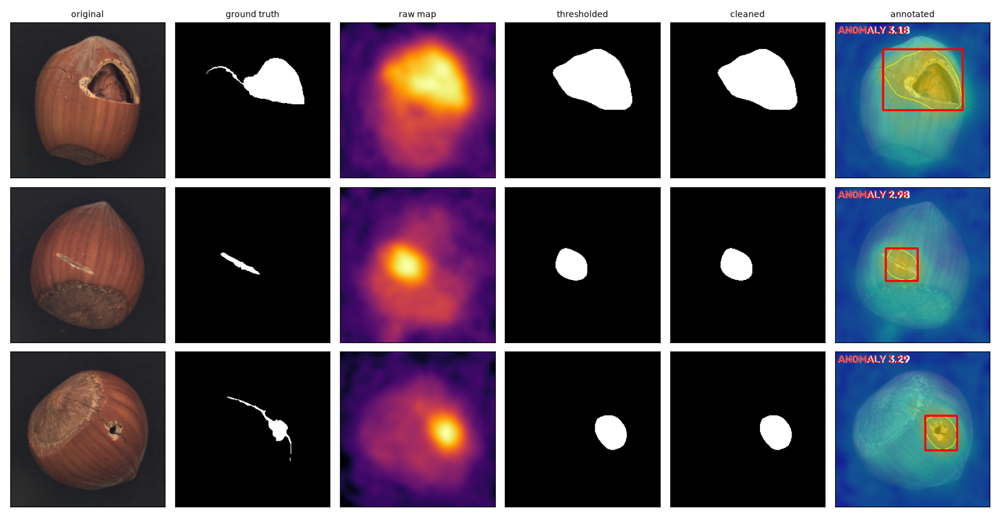

# Industrial visual inspection with PatchCore

Finding defective parts in product photos when you only have photos of good parts. This is my
own implementation of PatchCore (Roth et al., CVPR 2022) on the MVTec AD benchmark, without
`anomalib` or any other anomaly detection library. It tells you whether an image is defective
and where, and comes with an API, a small Streamlit app and Docker images. Everything runs on
a CPU.



## The idea in four steps

1. Push every defect-free training image through a frozen, ImageNet-pretrained ResNet-50 and
   keep the feature maps of two middle layers. Each image becomes 784 patch descriptors.
2. Keep a representative 10% of all those descriptors (greedy k-center coreset). That is the
   "memory bank" of what normal looks like. Nothing is trained.
3. For a new image, measure how far each of its patches is from the nearest entry in the bank.
   Far away means unusual. The largest patch distance is the image score, and the distances
   laid out as a grid give a heatmap.
4. Threshold the heatmap with OpenCV, clean it up and draw boxes around the suspicious regions.

The threshold for "defective" comes from a held-back 10% of the good training images, so no
test labels are used anywhere.

## Results

All 15 MVTec AD categories, one model per category:

| | Mine | PatchCore paper |
|---|---|---|
| Image AUROC (mean) | 0.985 | 0.989 |
| Pixel AUROC (mean) | 0.977 | 0.982 |
| AU-PRO (mean) | 0.906 | |

The paper uses a WideResNet-50 backbone, so a small gap is expected. Weakest categories are
screw (0.950), pill (0.956) and grid (0.964).

Inference takes about 0.6 seconds per image on my laptop (Ryzen 5 3500U, no GPU).

Things that did not work as well as I hoped:

- **The label-free threshold is the weak point.** AUROC is high, but the threshold is set from
  only 20 to 30 images. On screw it is so strict that recall drops to 0.49, on carpet and leather
  it is so loose that a third of the good images get flagged.
- **A two-stage cascade barely helps.** I put a cheap ResNet-18 check in front to let obviously
  good parts skip PatchCore. Letting half of the calibration normals through gives a speed-up of
  only 1.14x and wrongly skips 9% of the defective images.
- **The OpenCV morphology step changes almost nothing** (IoU 0.330 before, 0.329 after). The
  heatmap is already smooth from the Gaussian blur.
- With only 10 good images per category, hazelnut already reaches an image AUROC of 0.986.

Per-category tables, latency and memory, ONNX and faiss backends, ablations, few-shot and
robustness studies are in [docs/RESULTS.md](docs/RESULTS.md).

## Running it

Python 3.10+.

```bash
pip install --extra-index-url https://download.pytorch.org/whl/cpu -r requirements-dev.txt
pip install -e . --no-deps

mvinspect fetch-data          # downloads MVTec AD (about 5 GB)
mvinspect verify-data
mvinspect train --all         # about 90 minutes on my laptop
mvinspect evaluate --all      # about 30 minutes
mvinspect serve               # API on http://localhost:8000/docs
streamlit run app/streamlit_app.py
```

Train a single category with `mvinspect train bottle` if you just want to try it.
The dataset and the trained memory banks are not in the repo.

Inspect an image through the API:

```bash
curl -s -X POST "localhost:8000/v1/inspect?category=bottle" \
  -F "file=@data/mvtec_ad/bottle/test/broken_large/000.png"
```

The response has the anomaly score, the decision, bounding boxes and the heatmap as a base64 PNG.

Docker:

```bash
docker compose up --build     # API on :8000, app on :8501
```

Tests and lint: `make test`, `make lint`. Tests that need the dataset skip themselves if it is
missing.

## Layout

```
src/inspection/
  data.py          dataset index, splits, preprocessing
  features.py      ResNet feature extraction and patch descriptors
  coreset.py       greedy k-center selection
  patchcore.py     memory bank, scoring, anomaly maps
  knn.py           nearest-neighbour search (PyTorch or faiss)
  threshold.py     threshold calibration on held-back good images
  postprocess.py   OpenCV thresholding, contours, boxes, overlays
  cascade.py       the two-stage experiment
  metrics.py       AUROC, AU-PRO, bootstrap intervals
  evaluate.py      test-set evaluation
  studies/         ablations, few-shot, robustness
api/               FastAPI service
app/               Streamlit app
```

More: [architecture](docs/ARCHITECTURE.md), [decisions](docs/DECISIONS.md),
[model card](docs/MODEL_CARD.md), [known issues](docs/KNOWN_ISSUES.md).

## Limitations

- MVTec images are aligned and well lit. A real production line is not.
- One model per product type, so you need to know what you are looking at.
- The centre crop can cut off defects at the image border.
- About 73% of the MVTec test set is defective, which is nothing like a real line. Precision
  and the cascade numbers depend on that mix.
- AU-PRO is my own implementation, not the official evaluation code.
- The ablation, few-shot and robustness studies cover three categories and were run on a Colab
  GPU.

## Dataset and references

MVTec AD is licensed CC BY-NC-SA 4.0 (non-commercial) and is not redistributed here.

- Bergmann et al., "MVTec AD: A Comprehensive Real-World Dataset for Unsupervised Anomaly
  Detection", CVPR 2019
- Roth et al., "Towards Total Recall in Industrial Anomaly Detection", CVPR 2022
