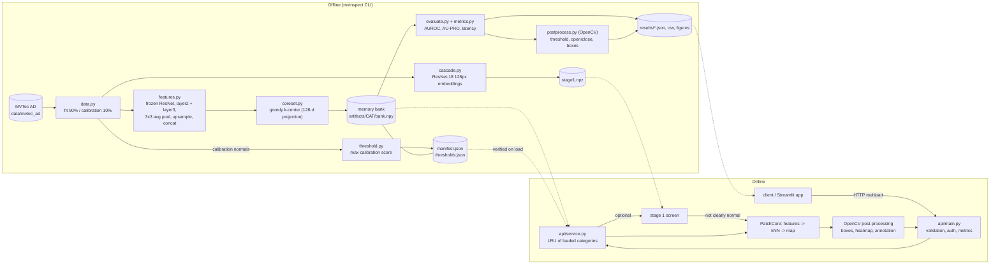

# Architecture

The diagram matches the code in `src/inspection`, `api` and `app`.

## Module map

| Module | Responsibility |
|---|---|
| `config.py` | pydantic-settings models, YAML plus `MVI_` environment overrides |
| `data.py` | category lists, listing, 90/10 split, geometry (resize 256, center crop 224), dataset verification |
| `fetch.py` | official download with Range resume, archive verification, safe extraction |
| `features.py` | frozen torchvision backbone, patch descriptor fusion |
| `coreset.py` | random projection and greedy k-center selection |
| `knn.py` | exact nearest neighbour (chunked matrix form with exact distance refinement) or faiss |
| `patchcore.py` | model class, descriptor cache, bank building, `train_category` |
| `threshold.py` | label-free calibration |
| `artifacts.py` | save and load with manifest and checksum verification |
| `metrics.py` | image AUROC and bootstrap CI, pixel AUROC, AU-PRO, threshold metrics |
| `evaluate.py`, `latency.py` | per-category evaluation, latency and memory measurement |
| `postprocess.py` | OpenCV mask cleanup, boxes, rendering, quantification |
| `cascade.py` | two-stage cascade study and stage-1 artifact |
| `onnx_backend.py` | ONNX export, parity check, backend benchmarks |
| `studies/` | ablations, few-shot, robustness, summaries |
| `report.py` | tables, baseline comparison, failure analysis |
| `api/` | FastAPI service (validation, concurrency control, Prometheus metrics) |
| `app/` | Streamlit client, HTTP only |

## Data flow and invariants

- Training uses only `train/good`. The memory bank sees the fit split; thresholds see the calibration split. The test split is only used for evaluation and for analysis labelled as such (oracle F1, alpha sensitivity).
- Every artifact carries a manifest: config hash, seed, backbone and weights identifier and checksum, dataset fingerprint, git commit, library versions, bank shape and bank checksum, thresholds. The loader refuses missing, mismatched or inconsistent artifacts. The model version reported by the API is a hash of the manifest.
- Box coordinates returned by the API are in the 224 x 224 center-cropped model frame, not the original upload frame.
- Device: `device` in the config selects `cpu` (reference) or `cuda`; only feature extraction, coreset selection and exact nearest-neighbour search move to the GPU. It is excluded from the config hash because it does not change the trained model, and the GPU path is checked against the CPU path (see DECISIONS D15).
- Concurrency: requests wait on a semaphore (default 1 slot), run in a thread pool, and are cut off by a timeout. At most two categories are kept loaded (LRU).
